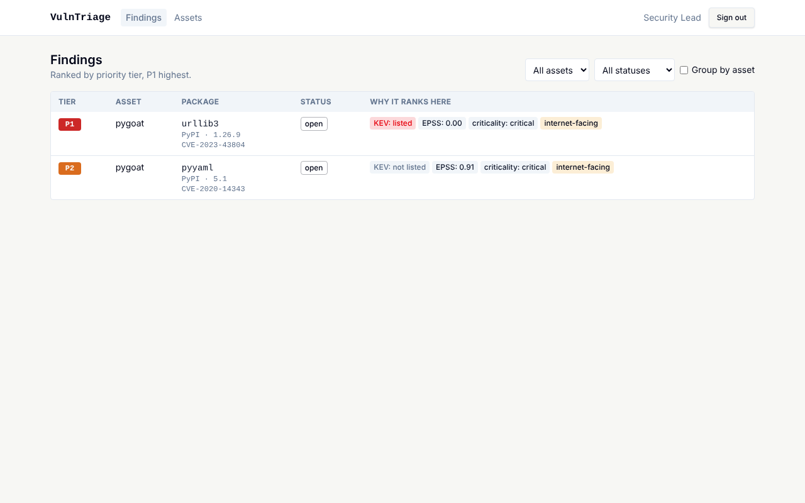
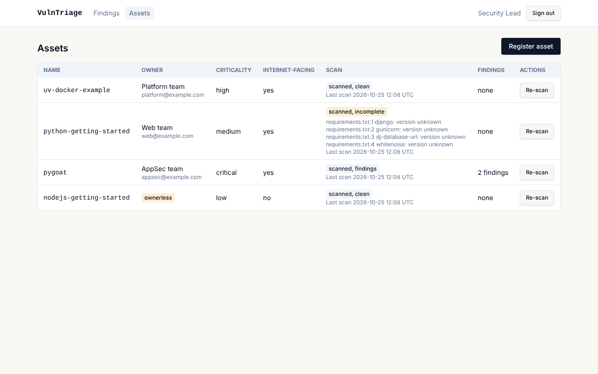
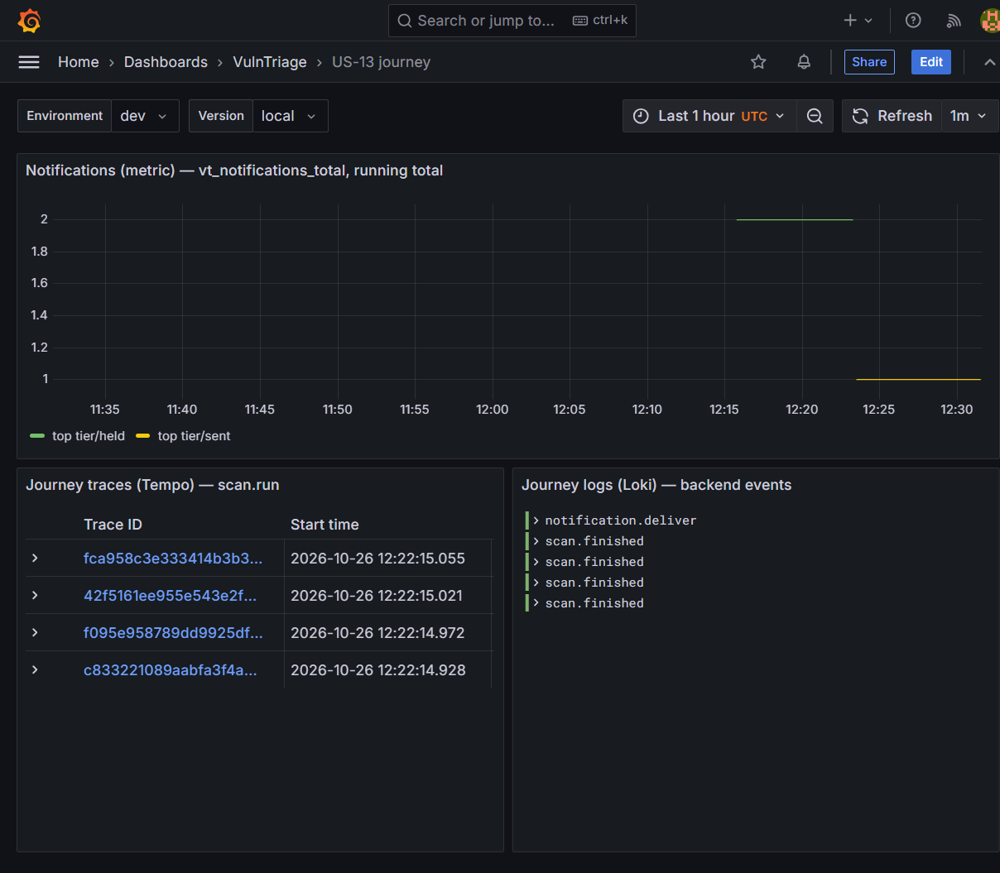
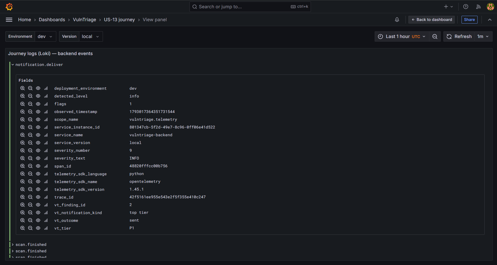
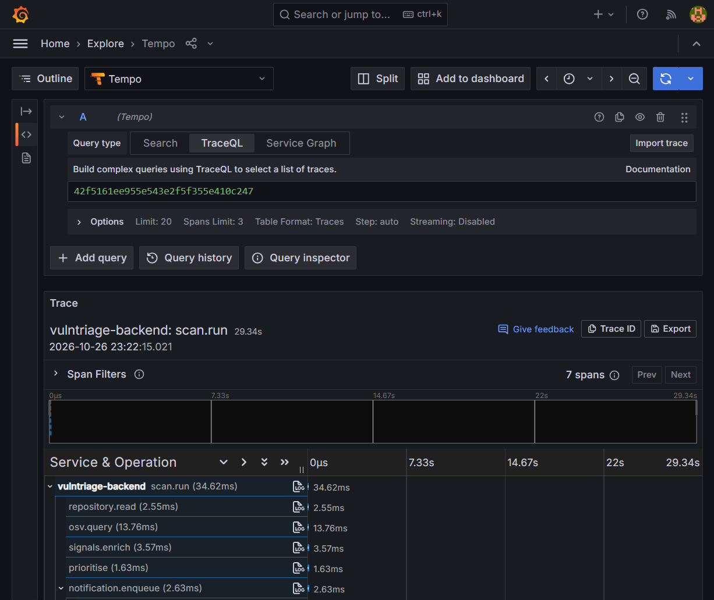

# VulnTriage

**Ranks vulnerable dependencies by real-world exploit risk and routes each fix to the owner who can make it.**

[](https://github.com/andrew-chung-au/vuln-triage/actions/workflows/verify.yml)

A full-stack security-triage tool: it reads an organisation's applications as *assets*, finds vulnerable dependencies, ranks every finding by evidence of real-world exploitation, notifies the owner who can fix the top-priority ones, and watches its own delivery with an alert and an on-call agent that opens a fix pull request.

**Stack:** React 19 + Vite + TypeScript · FastAPI + SQLAlchemy + Postgres (Python 3.12) · Docker Compose · Terraform on AWS + GitHub Actions · OpenTelemetry → Collector → Prometheus / Tempo / Loki / Grafana.

> **Status.** The application, tests, CI, observability, alerting and the on-call responder are built and working. The AWS deployment ran live (dev deployed automatically on merge, production promoted manually through an approval gate, with a rehearsed rollback) and was **taken down afterwards to avoid idle cost**. The Terraform and deploy workflow to recreate it are in the repository ([deployment guide](docs/deployment.md)). The quickest way to see the app is `make demo`, below. The LLM owner brief, n8n workflows and an MCP server are planned and clearly marked as not built ([roadmap](docs/roadmap.md)).

📹 **[Demo video: alert to fixed pull request](https://youtu.be/B4OvaHqAeyI)** (unlisted) — a recorded run of the on-call drill: the metric reaches 1, one alert names the finding, the responder opens a pull request, the owner merges it, and the alert resolves.



---

## The problem

Vulnerabilities are published faster than teams can triage them. Most do not affect a given organisation, but the few that do are hard to find. Hand-maintained asset lists go stale, severity alone does not show what attackers actually exploit, and findings that never reach an owner do not get fixed.

VulnTriage is for the security function of an organisation with many teams. The **security lead**, accountable for exposure, sees one ranked, explainable view across all assets; each **asset owner** gets the findings they can fix. It combines what is installed, what is known to be exploited in the wild, and who owns each asset:

- **One ranked view** across all assets, from real-world-exploitation evidence (CISA KEV and FIRST EPSS) plus the asset's criticality and internet-facing flag. Every rank comes with its reason, and **no AI is involved in the ranking.**
- **A named owner.** Each new top-priority finding notifies the owner who can fix it, exactly once.
- **Checked delivery.** An alert fires if a top-priority finding is not delivered.
- **Confirmed fixes.** A finding closes only when a re-scan shows the fixed version is in place.
- **A human decision on risk.** Accepting a risk is a human action, with an audit trail of who, when, the previous value and the reason.

## What it does

`inventory → match → enrich → rank → route → re-scan → watch & respond`

1. **Inventory.** Register apps and services as assets with an owner, criticality and internet-facing flag. Read each asset's `uv.lock`, `requirements.txt` and `package-lock.json` automatically.
2. **Match.** Query OSV.dev for known vulnerabilities in each installed package version, recording the fixed version when one exists.
3. **Enrich.** Add CISA KEV status, the FIRST EPSS probability, and the asset's criticality and exposure.
4. **Rank.** Give every finding a deterministic, explainable rank with a reason.
5. **Route.** A backend scheduler refreshes KEV and EPSS daily, re-scores findings, and notifies the owner of a new top-priority finding.
6. **Re-scan.** Close a finding automatically when a re-scan shows the fixed version in place.
7. **Watch & respond.** The scan-to-notification journey emits metrics, traces and structured logs sharing a trace ID, viewable in Grafana. An alert fires when a top-priority finding is not delivered; a responder agent wakes on it, investigates, and opens a fix pull request for a person to review. No customer data, advisory text or credentials go to telemetry.

A web dashboard lists findings per asset with status (`open`, `risk accepted`, `fixed`, `withdrawn`) and an audit trail; only a human can set `risk accepted`. VulnTriage does **not** actively scan networks or applications, does **not** patch software automatically, and the responder never merges.

**Expected behaviour** (each is covered by a named test, see [testing.md](docs/testing.md)):

- A new top-priority finding produces **exactly one** owner notification.
- A re-scan that finds the fixed version sets the finding to `fixed`; still-vulnerable versions stay `open`.
- A package with no fixed version stays `open` and is never given an invented fixed version.
- An ownerless asset's findings are still recorded and ranked; the notification is held and the dashboard flags the asset.
- If a feed is unavailable, last-known data is kept and marked stale, the run retries, and no findings are deleted.
- An undelivered top-priority finding fires **exactly one** alert.

The assets view shows each asset's scan status and owner, and flags an ownerless asset:



---

## Engineering highlights

- **Deterministic, explainable ranking.** Rank comes from KEV and EPSS evidence plus asset criticality and exposure, each with a human-readable reason, and no AI in the path, so scores are reproducible and auditable.
- **Exactly-once notifications.** Idempotency keys make a new top-priority finding yield one owner notification; re-scans close findings only when the fixed version is actually present.
- **Fail-closed safety switches.** `VT_FEEDS=fixtures` and the `VT_DEMO_DEFECT` demo switch refuse to run outside `dev` or `test`, so test-only behaviour cannot reach production. A production-promotion check fails the deploy if the demo defect is still in the tree.
- **Telemetry privacy enforced in code, not just policy.** A code-level allowlist *plus* a Collector processor strip customer data, advisory text, contact details, URLs and credentials, and a CI case asserts the excluded keys are absent from the Collector's output, Tempo and Loki.
- **A responder with defence in depth.** The agent only commits locally; the *runner* applies a diff gate, builds a single commit, and pushes a branch with a repository-scoped token that cannot touch `main`. No push credential is ever in the agent's environment. The limits are documented honestly, including what is *not* guaranteed ([responder.md](docs/responder.md)).
- **Least-privilege deployment.** No long-lived AWS keys: GitHub Actions assumes dev and prod roles through OIDC, scoped to the repository's `dev` and `production` environments. Production needs a required reviewer. No SSH, no key pair, secrets in Secrets Manager. A candid [security review](docs/security-review.md) of the Terraform records what was found and what was accepted.
- **Disciplined CI.** Every pull request runs unit, SQLite and Postgres integration, frontend, OpenAPI conformance and a Compose telemetry journey; `main` is protected by a ruleset with seven required checks. Tests use a network guard, so any live outbound call fails the test.
- **Built with AI agents under human control.** Role-separated agents (PM, engineer, independent QA) work inside a process with protected files, a verification gate, and human approval of every rule change ([how it was built](docs/ai-assisted-development.md)).

## Architecture

The backend ingests assets, reads their lockfiles with a read-only GitHub token, matches against OSV, enriches with KEV and EPSS, ranks deterministically, and delivers owner notifications. A background scheduler runs the daily refresh and re-scan. Telemetry flows over OTLP to an OpenTelemetry Collector, then to Prometheus (metrics), Tempo (traces) and Loki (logs), surfaced in Grafana. Observability, the alert and the responder run in local Docker Compose; the application itself (frontend, backend, Postgres) also deploys to AWS via Terraform.

```
assets ─▶ scan (OSV match) ─▶ enrich (KEV/EPSS) ─▶ rank ─▶ notify owner
                                                             │
   OpenTelemetry (trace id shared) ──▶ Collector ──▶ Prometheus / Tempo / Loki ──▶ Grafana
                                                             │
                               undelivered top-tier finding ─▶ alert ─▶ responder agent ─▶ fix PR
```

Full detail: [architecture.md](docs/architecture.md) · API contract: [openapi.yaml](docs/openapi.yaml) ([endpoint table](docs/api.md)).

---

## Quick start

**Prerequisites:** Python 3.12, [uv](https://docs.astral.sh/uv/), Node.js 24, GNU Make. Docker (with `docker compose`) only for the containerised stack. `make tool-versions` checks them.

```sh
git clone https://github.com/andrew-chung-au/vuln-triage.git
cd vuln-triage
make install        # frontend via npm ci; backend and responder via uv sync --locked
make demo           # migrate, create a user, start backend + frontend, register four demo repositories
# open http://127.0.0.1:5173 and sign in as  lead / demo-password-local
make dev-stop       # stop it;  make demo-reset  also deletes the dev database
```

`make demo` runs the real app on SQLite against **recorded** copies of four public repositories and of the OSV, KEV and EPSS feeds (`VT_FEEDS=fixtures`), so there is no network and no Docker. The KEV and EPSS values are fixture values, not live data. Expect four assets: one with two ranked findings (P1 `urllib3` CVE-2023-43804 and P2 `pyyaml` CVE-2020-14343), one scan marked incomplete, and one ownerless asset.

Other ways to run it:

```sh
make dev            # backend + frontend on SQLite with your own data (see docs/development.md)
make compose-up     # full stack in Docker: frontend + backend + Postgres, at http://localhost:8080
make test           # frontend (Vitest) + backend (pytest) + responder (pytest)
make verify         # the full gate CI runs
```

Everything else (creating logins, running on Postgres, the Compose test journeys, troubleshooting) is in the [development guide](docs/development.md).

## Testing & CI

- **One command:** `make test` runs the frontend, backend and responder suites. The Postgres-integration suite runs with `make test-integration`, and the Compose journeys with `make test-compose JOB=<telemetry|alert|responder>`.
- **CI** runs on every push and pull request via [`verify.yml`](.github/workflows/verify.yml). The deploy workflow is gated on a repository variable so merges do not try to deploy to infrastructure that is not running.
- Backend tests use a **network guard** (any outbound HTTP call fails the test) and stubbed feeds, so they need no live network or secret.
- Test strategy and the named cases: [testing.md](docs/testing.md).

## Observability

The key journey, a scan through to the owner notification, is instrumented with **metrics, traces and structured logs that share one trace ID**, exported over OTLP and viewable side by side in Grafana. Config and the dashboard are in [`observability/`](observability/).

| What it shows | Screenshot |
|---|---|
| **The journey dashboard** with data in all three panes: the notifications metric, recent `scan.run` traces from Tempo, and backend events from Loki |  |
| **One `notification.deliver` log event in Loki**, carrying the same `trace_id`, an outcome and a tier |  |
| **The same trace in Tempo:** `scan.run` with seven spans, ending in `notification.deliver` |  |

Captured on the local Compose stack after one `make demo` journey against recorded fixtures. The metric-to-trace link (a Prometheus exemplar carrying the trace ID) is asserted in CI and shown in the [responder drill evidence](docs/responder.md#live-run).

## Alerting & on-call agent

- **Alert.** When a top-priority finding is not delivered within the window, a provisioned Grafana rule fires **exactly one** alert naming the finding, to the owner's email and the responder, from real stored job state (not a simulation). Held jobs are exempt. Rule: [`observability/grafana/provisioning/alerting/`](observability/grafana/provisioning/alerting).
- **On-call agent.** A responder wakes on that alert, investigates the failed job in a fresh checkout with a headless `claude -p` agent, adds a test and fixes the code. The runner then checks the commits, pushes `responder/<fingerprint>` and opens a pull request, logging every action. A person reviews and merges; the responder cannot. It has a stub mode (used in CI) and a real mode (a headless agent on the operator's own Claude login, no API key).
- **Live run.** The real mode ran: the alert reached the responder, the agent fixed a planted defect, the runner opened [PR #265](https://github.com/andrew-chung-au/vuln-triage/pull/265), the owner merged it, and the alert resolved. It was a scripted drill, so the agent is told the defect is planted. Details, screenshots and the honest limits are in [responder.md](docs/responder.md).

## Deployment

One AWS server runs the `dev` and `prod` Compose projects behind a reverse proxy, provisioned by three Terraform modules; images are built once and pushed to GHCR. A merge to `main` deploys to dev automatically; production is a manual promotion through a required-reviewer gate, and rollback is a promotion of an earlier tag. This was run live and rehearsed, then **torn down to avoid idle cost**. [`terraform/`](terraform) and the [deployment guide](docs/deployment.md) include everything needed to recreate it (roughly $25 to $40 a month while up, about nothing when down), with screenshots from the live system.

## Roadmap

Planned next, in themes: operations and hardening (one-command on-demand demo, least-privilege deploy roles, a "Launch demo" button), product (an LLM owner brief with a fixed-version guardrail, a read-only MCP server, n8n workflows), and cloud observability (Grafana and the responder on AWS). Known limitations are listed too. See the [roadmap](docs/roadmap.md).

## Documentation

| Document | Contents |
|---|---|
| [specs.md](docs/specs.md) | Product spec: user stories US-1…US-15 with acceptance lines, edge cases |
| [architecture.md](docs/architecture.md) | Components, data model, prioritisation, security boundaries, observability, deployment |
| [api.md](docs/api.md) · [openapi.yaml](docs/openapi.yaml) | API contract (OpenAPI 3.1) and endpoint table |
| [testing.md](docs/testing.md) | Test strategy and named cases |
| [development.md](docs/development.md) | Install, run and test locally |
| [deployment.md](docs/deployment.md) | AWS deployment, CI/CD, and how to recreate or tear it down |
| [responder.md](docs/responder.md) | The on-call agent, its security limits, and the live run |
| [security-review.md](docs/security-review.md) | Review of the Terraform before first apply |
| [roadmap.md](docs/roadmap.md) | What is built, what is next, known limitations |
| [ai-assisted-development.md](docs/ai-assisted-development.md) | How the agent team and process worked |

The planning, review and session record from the first build is preserved at the [`v1.0.0` tag](https://github.com/andrew-chung-au/vuln-triage/tree/v1.0.0).

## License

[MIT](LICENSE).

### Glossary

**OSV** Open Source Vulnerabilities database (osv.dev) · **KEV** CISA Known Exploited Vulnerabilities catalog · **EPSS** FIRST Exploit Prediction Scoring System · **MCP** Model Context Protocol · **OTLP** OpenTelemetry Protocol · **SPA** single-page application · **GHCR** GitHub Container Registry.
