# VulnTriage

**Ranks vulnerable dependencies by real-world exploit risk and routes each fix to the owner who can make it.**

[](https://github.com/andrew-chung-au/vuln-triage/actions/workflows/verify.yml)

> **Status.** Implemented: a full-stack app (React + FastAPI + Postgres), Docker Compose, CI, OpenTelemetry→Grafana observability and a US-14 alert (verified in CI). **Not built yet:** the on-call responder agent (US-15), which is planned. The **dev** environment is live on AWS at https://dev.52-206-221-145.sslip.io and **production** at https://app.52-206-221-145.sslip.io (both deployed by the GitHub workflow on 2026-10-25, with a rehearsed rollback; see [Deployment](#deployment--rollback)). The LLM brief, n8n workflows and MCP server are future development, planned after submission and marked as such throughout (older documents call this track "Showcase").

---

## For reviewers — start here

**What it is:** a security-triage tool. It ingests an organisation's apps as *assets*, finds vulnerable dependencies, ranks every finding by evidence of real-world exploitation, and notifies the asset owner who can fix the top-priority ones — with delivery checked by an alert and an on-call agent.

**Tech stack:** React 19 + Vite + TypeScript (frontend) · FastAPI + SQLAlchemy + Postgres (backend, Python 3.12) · Docker Compose · Terraform on AWS + GitHub Actions (CI/CD) · OpenTelemetry → Collector → Prometheus / Tempo / Loki / Grafana (observability).

**Run it (one command each):**

```sh
make install     # frontend (npm ci) + backend (uv sync)
make dev         # run the whole app locally on SQLite — no Docker
make compose-up  # OR run the full stack (frontend + backend + Postgres) in Docker
make test        # run the unit + integration suites
```

See [Quick start](#quick-start) for the few-minute version, including creating a login.

### Where to find each rubric criterion

The 12 criteria, what we did for each, and where to see it. Links go straight to the evidence.

| # | Criterion | What we did | Where |
|---|---|---|---|
| 1 | **Problem Description** | Problem, functionality and expected behaviour, below | [The problem](#the-problem) · [What it does](#what-it-does) · [Expected behaviour](#expected-behaviour) |
| 2 | **Product Specification** | Spec with acceptance criteria + public GitHub Issues tracker the agents used | [`_docs/specs.md`](_docs/specs.md) · [Issues](https://github.com/andrew-chung-au/vuln-triage/issues) · [tasks](_docs/tasks.md) |
| 3 | **Agent Team Specification** | Six agent roles + the human, tools/models, QA independence, issue lifecycle | [`_docs/agent-team.md`](_docs/agent-team.md) |
| 4 | **Context Management** | `AGENTS.md` describes the project and links the modular docs | [`AGENTS.md`](AGENTS.md) |
| 5 | **Application** | Full-stack, end to end, data in Postgres; one-command local run | [Quick start](#quick-start) · `backend/` · `frontend/` |
| 6 | **Testing** | Unit + integration (SQLite + Postgres), one command, pass in CI | [Testing & CI](#testing--ci) |
| 7 | **Containerization** | Frontend + backend + Postgres via Compose, one command | [`compose.yaml`](compose.yaml) · [Quick start](#quick-start) |
| 8 | **Deployment** | Terraform on AWS, `sslip.io` URL / demo | [Deployment](#deployment--rollback) |
| 9 | **CI/CD** | CI on every PR; auto-deploy to dev on merge; manual prod promotion | [Testing & CI](#testing--ci) · [Deployment](#deployment--rollback) |
| 10 | **Observability** | Scan→notification journey: metric, trace & log share one trace ID in Grafana; no PII/secrets in telemetry | [Observability](#observability) · [`observability/`](observability/) |
| 11 | **Alerting on User Impact** | An undelivered top-priority finding fires exactly one alert | [Alerting & on-call](#alerting--on-call-agent) |
| 12 | **On-Call Agent** | Planned, not built yet: a responder agent that wakes on the alert and opens a fix PR | [Alerting & on-call](#alerting--on-call-agent) |

<!-- PLACEHOLDER: if you record a demo video / drill, link it here and in Deployment:
### Demo recording
📹 [Watch the end-to-end drill](<URL>) — metric at 1 → one alert naming the finding → responder PR → owner email in MailHog → alert resolves.
-->

---

## The problem

Vulnerabilities are published faster than teams can triage them. Most do not affect a given organisation, but the few that do are hard to find. Hand-maintained asset lists go stale, severity alone does not show what attackers actually exploit, and findings that never reach an owner do not get fixed.

VulnTriage is for the security function of an organisation with many teams. The **security lead**, accountable for exposure, sees one ranked, explainable view across all assets; each **asset owner** (the team that owns the code) gets the findings they can fix. It combines what is installed, what is known to be exploited in the wild, and who owns each asset, then routes the work to that person:

- **One ranked view** across all assets, from real-world-exploitation evidence (CISA KEV and FIRST EPSS) plus the asset's criticality and internet-facing flag. Every rank comes with its reason, and **no AI is involved in the ranking.**
- **A named owner.** Each new top-priority finding notifies the owner who can fix it.
- **Checked delivery.** An alert fires if a top-priority finding is not delivered.
- **Confirmed fixes.** A finding closes only when a re-scan shows the fixed version is in place.
- **A human decision on risk.** Accepting a risk is a human decision, with an audit trail of who, when, the previous value and the reason.

## What it does

The submission path runs end to end: inventory → match → enrich → rank → route → re-scan → watch & respond. (Glossary of acronyms at the end.)

1. **Inventory.** Register apps/services as assets with an owner, criticality and internet-facing flag. Read each asset's `uv.lock`, `requirements.txt` and `package-lock.json` automatically.
2. **Match.** Query OSV.dev for known vulnerabilities in each installed package version, recording the fixed version when one exists.
3. **Enrich.** Add CISA KEV status, the FIRST EPSS probability, and the asset's criticality/exposure.
4. **Rank.** Give every finding a deterministic, explainable rank with a reason. No AI.
5. **Route.** The backend refreshes KEV/EPSS daily on its own scheduler, re-scores findings, and notifies the owner of a new top-priority finding.
6. **Re-scan.** Close a finding automatically when a re-scan shows the fixed version is in place.
7. **Watch & respond.** The scan→notification journey emits metrics, traces and structured logs sharing a trace ID, viewable in Grafana. An alert fires when a top-priority finding is not delivered; a responder agent (planned, not built yet) is meant to wake on it, open a fix PR, and log its actions (promotion to production stays manual). No customer data, advisory text or credentials go to telemetry.

A **web dashboard** lists findings per asset with status (`open`, `risk accepted`, `fixed`, `withdrawn`) and an audit trail; only a human can set `risk accepted`.

**Planned next, after submission:** an LLM brief for owners (with a fixed-version guardrail), n8n workflows (GitHub issue, reminders, escalation, weekly digest), and a read-only MCP server. See the [future-development section of the spec](_docs/specs.md#future-development-after-submission).

VulnTriage does **not** actively scan networks/applications, does **not** patch software automatically, and exposes **no** write tools through MCP.

## Expected behaviour

- A new top-priority finding produces **exactly one** owner notification.
- A re-scan that finds the fixed version sets the finding to `fixed`; still-vulnerable versions stay `open`.
- A package with no fixed version stays `open` and is never given an invented fixed version.
- An ownerless asset's findings are still recorded and ranked; the notification is held and the dashboard flags the asset as ownerless.
- If an OSV/KEV/EPSS feed is unavailable, last-known data is kept and marked stale, the scheduled run retries, and no findings are deleted.
- Only a human can set `risk accepted`; the audit trail records who, when and the previous value.
- An undelivered top-priority finding fires **exactly one** alert. Once the responder agent exists (planned), its actions will be logged; production promotion stays manual.

---

## Quick start

**Prerequisites:** Python 3.12, [uv](https://docs.astral.sh/uv/), Node.js 24, GNU Make. Docker (with `docker compose`) only for the containerised stack. Run `make tool-versions` to check. Full detail: [`_docs/verify-locally.md`](_docs/verify-locally.md).

```sh
git clone https://github.com/andrew-chung-au/vuln-triage.git
cd vuln-triage
make install        # frontend via `npm ci`, backend via `uv sync --locked`
```

### Option A — local, no Docker (`make dev`)

```sh
make dev
# backend (FastAPI, SQLite) on http://127.0.0.1:8000
# frontend (React/Vite) on http://127.0.0.1:5173  — Ctrl-C stops both
```

There is **no sign-up** (by design). Create a dashboard login with the operator command, then sign in at `http://127.0.0.1:5173`:

```sh
cd backend && uv run python -m vulntriage.manage create-user \
  --username lead --display-name "Security Lead" --email lead@example.com --role "security lead"
# prompts for a password (never passed on the command line)
```

### Option B — full stack in Docker (`make compose-up`)

```sh
cp .env.example .env     # fill in POSTGRES_PASSWORD, GRAFANA_ADMIN_PASSWORD, etc. (names only in the example)
make compose-up          # builds + starts frontend + backend + Postgres, one command
# ...
make compose-down        # stop
```

> **Docker Desktop on Windows (WSL) says `ports are not available ... /forwards/expose ... 500`?** Another Windows program already holds that host port, and VS Code's automatic port forwarding can be that program. Open VS Code's **Ports** panel, right-click the port and choose **Stop Forwarding Port**, and untick the setting `remote.autoForwardPorts`. To find the owner of any port from WSL: `netstat.exe -ano | grep :<port>`, then `tasklist.exe /FI "PID eq <pid>"`. Details: [`_docs/verify-locally.md`](_docs/verify-locally.md) Troubleshooting. Option A needs no Docker and is not affected.

Both options serve the SPA and the API on one origin (the API lives under `/api`; the proxy strips the prefix), so no CORS setup is needed.

---

## Try it as a reviewer

There is no sign-up, so these are the logins to use. They are **public demo accounts, meant to be shared**: the data behind them is fictional or public, and nothing sensitive should be entered.

### Live demo

| | |
|---|---|
| URL | https://dev.52-206-221-145.sslip.io |
| Username | `reviewer` |
| Password | `vt-reviewer-demo` |
| Role | security lead: sees every asset and finding, can register an asset, can accept a risk |

The dashboard lists the registered demo repositories with their scan status and ranked findings. Registering an asset takes any public `https://github.com/<owner>/<repo>` that has a `uv.lock`, `requirements.txt` or `package-lock.json`. The live demo runs on a small server that may be stopped overnight to save cost; if it does not answer, try again later or use the local demo below.

### Local demo (no Docker, no network, a few minutes)

This runs the real app on its SQLite path against **recorded** copies of four public repositories and the OSV/KEV/EPSS feeds, so the KEV and EPSS values are fixture values, not live data.

```sh
make install
make demo          # everything below in one command; then sign in as  lead / demo-password-local
make dev-stop      # stop it;  make demo-reset  stops it and deletes the dev database
```

The same thing step by step, if you want to see what `make demo` does:

```sh
make dev-start VT_FEEDS=fixtures DEPLOYMENT_ENVIRONMENT=dev   # migrates, then starts backend and frontend
printf '%s\n' 'demo-password-local' | uv run --directory backend python -m vulntriage.manage create-user \
  --username lead --display-name "Security Lead" --email lead@example.com --role "security lead"
VT_SEED_PASSWORD='demo-password-local' python3 deploy/seed-pilot.py \
  --base-url http://127.0.0.1:8000 --username lead --seed-file deploy/demo-seed.json --wait 60
# open http://127.0.0.1:5173 and sign in as  lead / demo-password-local
make dev-stop
```

Expected: four assets, one with two ranked findings (P1 `urllib3` CVE-2023-43804 and P2 `pyyaml` CVE-2020-14343), one scan marked incomplete, and one asset shown as ownerless. `VT_FEEDS=fixtures` is refused unless `DEPLOYMENT_ENVIRONMENT` is `dev` or `test`, so it can never run in production. Run `make demo-reset` (or delete `backend/.scratch/vulntriage.db`) to start over; running `make demo` twice registers the four repositories twice.

---

## Screenshots & demo

The app running on its one-command local path (`make dev`: SQLite, no Docker), signed in through the real login form against the real API. The data is **demo data**: four public repositories replayed from the committed recorded fixtures (`VT_FEEDS=fixtures`, no network), so the KEV/EPSS values are fixture values, not live feeds.

| Findings — ranked, with the reason for each rank | Assets — scan status, owner, and an ownerless asset |
|---|---|
| 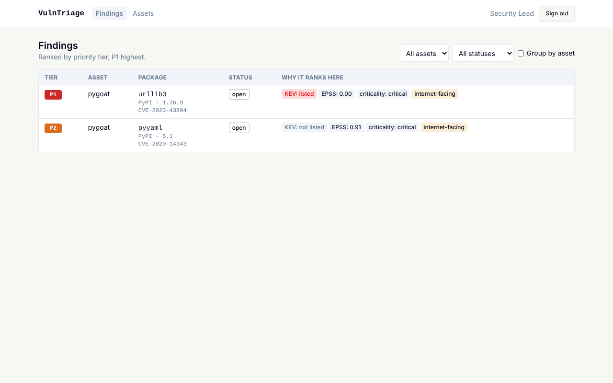 | 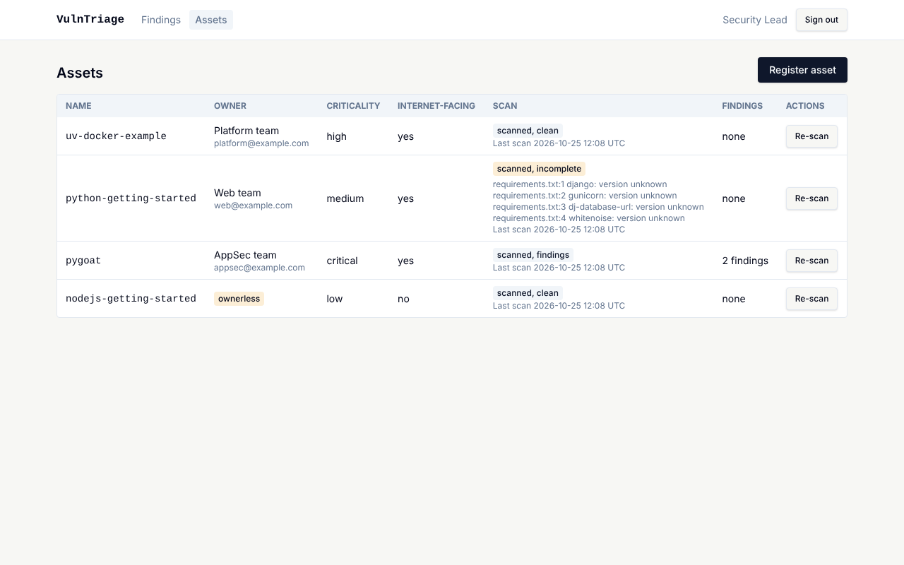 |

### Deployment evidence

Captured 2026-10-25 and 2026-10-26 from the live deployment and the GitHub settings pages.

| What it shows | Screenshot |
|---|---|
| **Production needs a reviewer.** The `production` environment has Required reviewers on and "Allow administrators to bypass" off; only `main` can deploy | 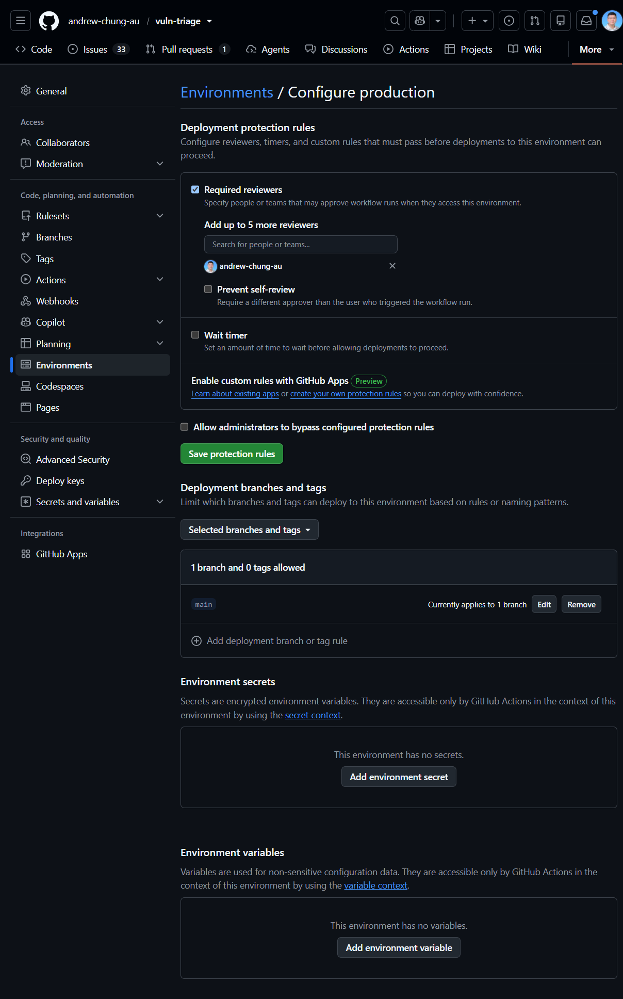 |
| **A production deploy waiting for approval** (run #33): the job stops at "waiting for review" until the reviewer approves | 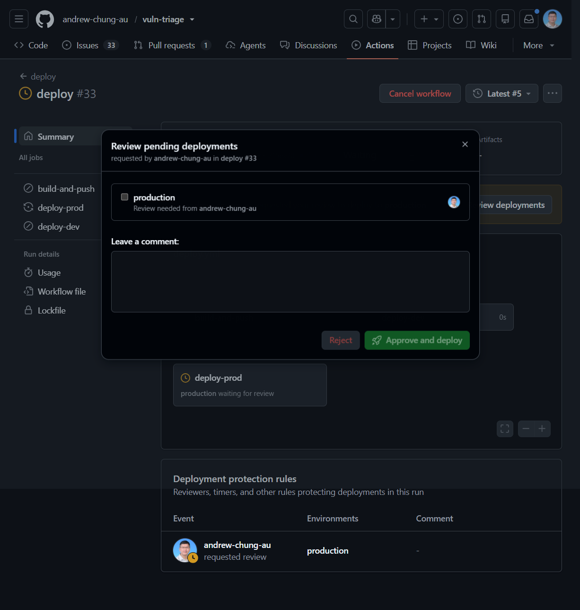 |
| **Dev deploys automatically on merge** (run #30, triggered by a push to `main`): build and dev deploy run, production is skipped | 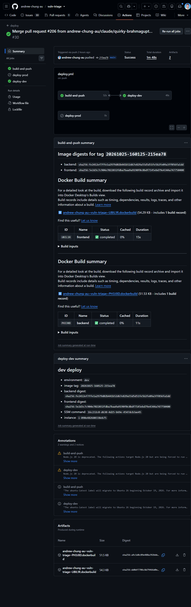 |
| **Rollback rehearsal** (run #32, attempt 1): production was deployed from an earlier image tag through the approval gate, approved by the owner | 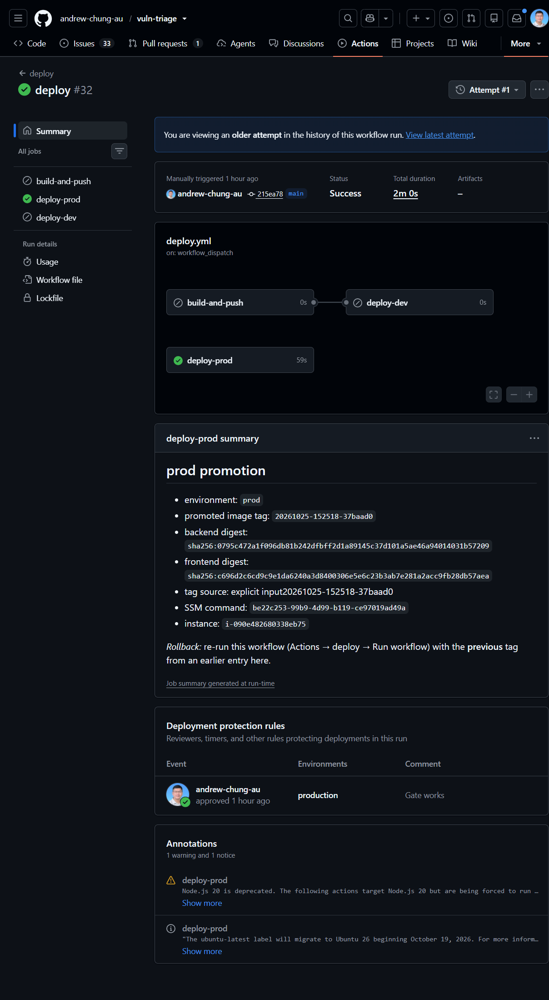 |
| **`main` is protected** by the `protect-main` ruleset: pull request required, status checks required, no force pushes, no deletion | 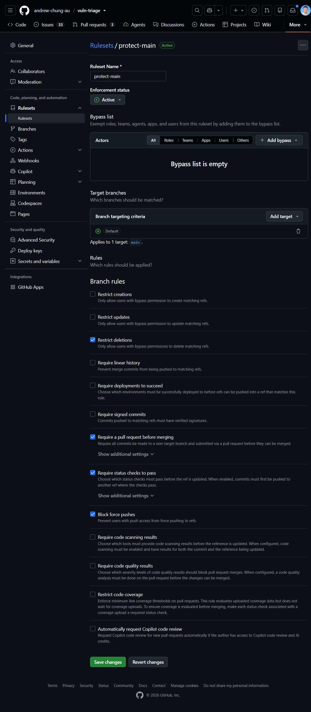 |
| **Dev only deploys from `main`** (no reviewer, since dev deploys automatically) | 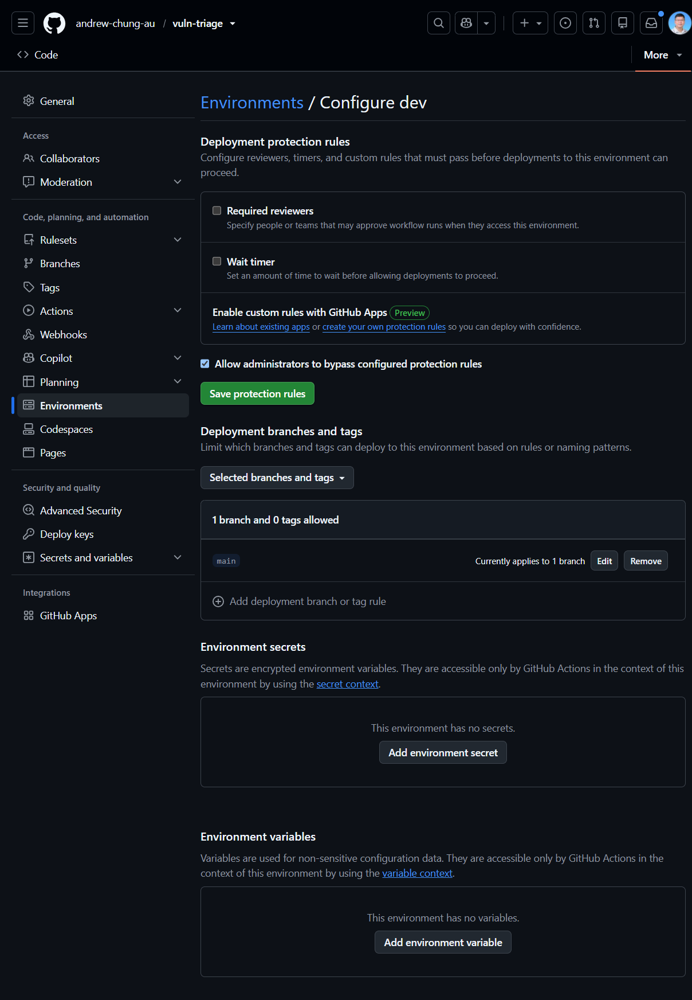 |
| **The live dev site**, signed in as the public reviewer, showing ranked findings for the demo repositories | 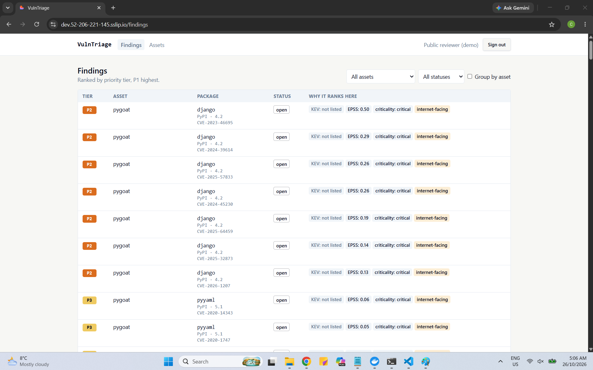 |
| **The live production site**: the sign-in page at `app.52-206-221-145.sslip.io` over HTTPS (production has no public account) | 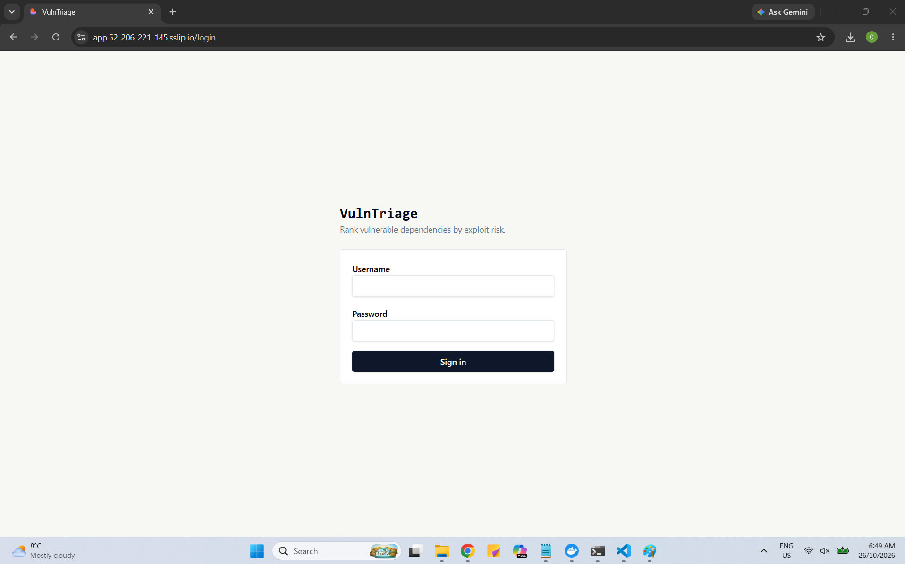 |

### Observability evidence

Captured 2026-10-26 on the local Compose observability stack ([`observability/`](observability/)) after one journey run of `make demo` against the recorded fixtures (`VT_FEEDS=fixtures`), so the findings are demo data. One trace ID, `42f5161ee955e543e2f5f355e410c247`, appears in both the log event and the trace below.

| What it shows | Screenshot |
|---|---|
| **The US-13 dashboard** with data in all three panes: the notifications metric (`top tier/held` green, `top tier/sent` yellow), recent `scan.run` traces from Tempo and backend events from Loki. The Environment and Version dropdowns visible here were removed afterwards: they were not connected to any panel (issue #199) | 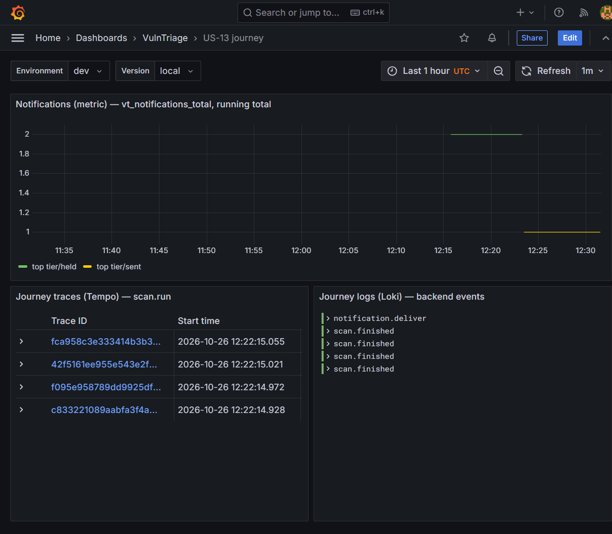 |
| **One `notification.deliver` log event in Loki**, expanded: it carries `trace_id` `42f5161ee955e543e2f5f355e410c247`, `vt_outcome` `sent` and `vt_tier` `P1` | 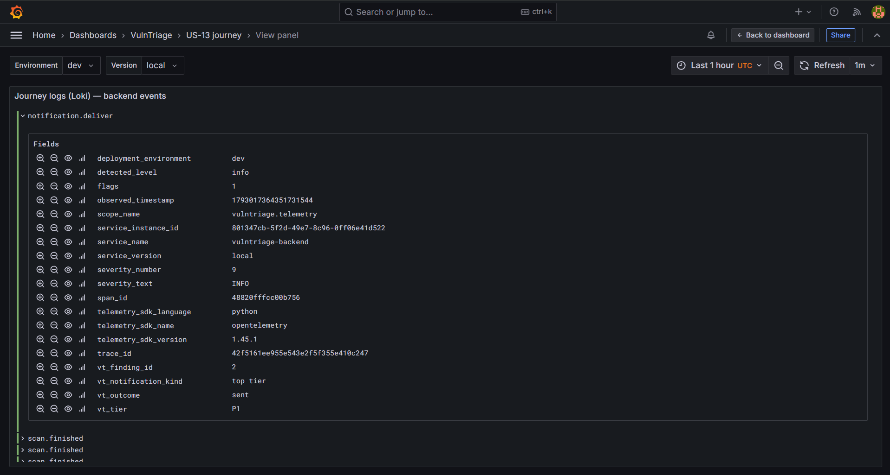 |
| **The same trace in Tempo** (Grafana Explore, TraceQL): `scan.run` with 7 spans. The list is cut off after `notification.enqueue`; the seventh span is `notification.deliver`. The visible spans take milliseconds; the trace's overall duration is 29.34 s | 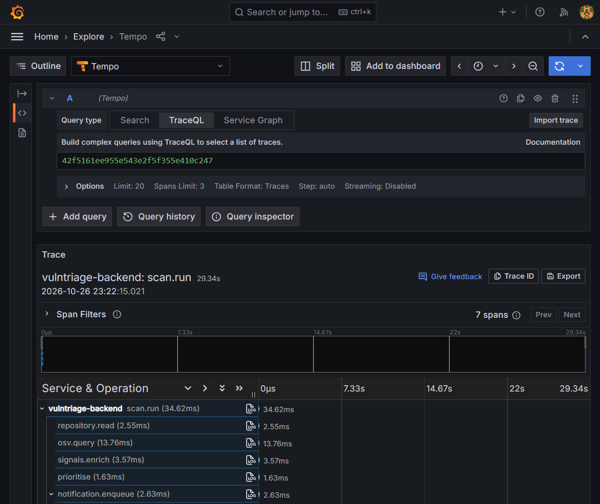 |

_Not captured yet: the recorded end-to-end drill and the responder pull request (the responder is not built)._


<!-- PLACEHOLDER: link the recorded drill here if you have one:
📹 **Demo recording:** [end-to-end drill](<URL>) — shows the metric at 1, one alert naming the finding, the responder opening a PR, the owner email arriving in MailHog, and the alert resolving.
-->

---

## Architecture

The backend ingests assets, reads their lockfiles with a read-only GitHub token, matches against OSV, enriches with KEV/EPSS, ranks deterministically, and delivers owner notifications. A background scheduler runs the daily refresh and re-scan. Telemetry flows from the backend over OTLP to an OpenTelemetry Collector, then to Prometheus (metrics), Tempo (traces) and Loki (logs), surfaced in Grafana. For submission the observability stack and the alert run in local Docker Compose (the responder is planned to join them); the app itself (frontend + backend + Postgres) also deploys to AWS via Terraform.

Full detail: [`_docs/architecture.md`](_docs/architecture.md) · API contract: [`_docs/openapi.yaml`](_docs/openapi.yaml) ([endpoint table](_docs/api.md)).

```
assets ─▶ scan (OSV match) ─▶ enrich (KEV/EPSS) ─▶ rank ─▶ notify owner
                                                             │
   OpenTelemetry (trace id shared) ──▶ Collector ──▶ Prometheus / Tempo / Loki ──▶ Grafana
                                                             │
                               undelivered top-tier finding ─▶ alert ─▶ (planned) responder agent ─▶ fix PR
```

---

## Deployment & rollback

- **How it deploys.** `terraform/` (bootstrap, deploy-roles, server) provisions one AWS server that runs the `dev` and `prod` Compose projects behind a reverse proxy, with images in GHCR. Hostnames come from the Elastic IP via `sslip.io` (no domain to buy): dev at https://dev.52-206-221-145.sslip.io (live), prod at `https://app.52-206-221-145.sslip.io` (live, promoted manually).
- **CI/CD.** Every PR runs the test jobs ([`verify.yml`](.github/workflows/verify.yml)). A merge to `main` **auto-deploys to dev** when tests pass; **production is a manual promotion** the human approves ([`deploy.yml`](.github/workflows/deploy.yml)) (both the dev deploy and a production promotion have run on a real server).
- **Rollback.** Re-run the production workflow with the previous image tag; the deploy log records every tag and digest. This was rehearsed: production was rolled back to an earlier tag through the approval gate, then promoted forward again.

> The first live deploy is a human-run AWS step (account, secrets, `terraform apply`), tracked in [`_docs/aws-setup.md`](_docs/aws-setup.md). The Deployment criterion accepts *a public URL **or** a clear demo of the deployment.*

<!-- If the deployment is not kept live at submission, link the demo recording instead (see Screenshots & demo). -->

---

## Testing & CI

- **One command:** `make test` runs the frontend (Vitest) and backend (pytest) suites.
- **Unit + integration.** Backend unit cases and SQLite-integration cases run under `make test`; the Postgres-integration suite runs with `make test-integration`; the Docker Compose journeys (telemetry / alert / responder) run with `make test-compose JOB=<telemetry|alert|responder>`.
- **CI** runs the suites on every push and pull request via [`verify.yml`](.github/workflows/verify.yml) ([recent runs](https://github.com/andrew-chung-au/vuln-triage/actions/workflows/verify.yml)).
- Backend tests use a network guard (any outbound HTTP call fails the test) and stubbed feeds, so they need no live network or secret.

## Observability

The key journey — a scan through to the owner notification — is instrumented with **metrics, traces and structured logs that share one trace ID**, exported over OTLP to the Collector and viewable side by side in Grafana (Prometheus / Tempo / Loki panes). A code-level allowlist plus a Collector processor keep customer data, advisory text, owner contact details, URLs and credentials **out** of telemetry. Config and the US-13 dashboard live in [`observability/`](observability/). Screenshots of a live run (the dashboard, a log event and the trace sharing one trace ID) are under [Observability evidence](#observability-evidence).

## Alerting & on-call agent

- **Alert (US-14).** When a top-priority finding is not delivered within the window, a provisioned Grafana rule fires **exactly one** alert naming the finding — to the owner's email and the responder — from real stored job state (not a simulation). Held jobs are exempt. Rule: [`observability/grafana/provisioning/alerting/`](observability/grafana/provisioning/).
- **On-call agent (US-15) — planned, not built yet.** The design: a responder agent wakes on that alert, reproduces the notification defect, opens a pull request with a fix and a test, and logs its actions; promotion to production stays manual. Progress is tracked in issue [#160](https://github.com/andrew-chung-au/vuln-triage/issues/160).

---

## Further reading

<details>
<summary><strong>All planning & process docs</strong> (click to expand)</summary>

**Product & build**
- [`_docs/project-brief.md`](_docs/project-brief.md) — problem, workflow, success criteria
- [`_docs/specs.md`](_docs/specs.md) — product spec (US-1…US-15, acceptance lines); [future development](_docs/specs.md#future-development-after-submission)
- [`_docs/tasks.md`](_docs/tasks.md) — numbered build backlog, coverage summary, dependency chain
- [`_docs/roadmap.md`](_docs/roadmap.md) — order of work and progress check-ins

**Architecture & contract**
- [`_docs/architecture.md`](_docs/architecture.md) — architecture (Stage 2)
- [`_docs/openapi.yaml`](_docs/openapi.yaml) — API contract (OpenAPI 3.1) · [`_docs/api.md`](_docs/api.md) — endpoint table
- [`_docs/testing.md`](_docs/testing.md) — test strategy (future-development cases marked, not counted)

**Process & AI workflow**
- [`_docs/agent-team.md`](_docs/agent-team.md) — roles, tools/models, hand-overs
- [`_docs/ai-usage-log.md`](_docs/ai-usage-log.md) — append-only record of AI-assisted work
- [`_docs/prompts/README.md`](_docs/prompts/README.md) — index of key prompts
- [`AGENTS.md`](AGENTS.md) — project context entrypoint (imported by `CLAUDE.md`)

**Running & deploying**
- [`_docs/verify-locally.md`](_docs/verify-locally.md) — install, test, run the app locally
- [`_docs/aws-setup.md`](_docs/aws-setup.md) · [`_docs/terraform-verify.md`](_docs/terraform-verify.md) — AWS/Terraform setup and checks

</details>

### Glossary

**OSV** Open Source Vulnerabilities database (osv.dev) · **KEV** CISA Known Exploited Vulnerabilities catalog · **EPSS** FIRST Exploit Prediction Scoring System · **MCP** Model Context Protocol · **OTLP** OpenTelemetry Protocol · **SPA** single-page application · **GHCR** GitHub Container Registry.
