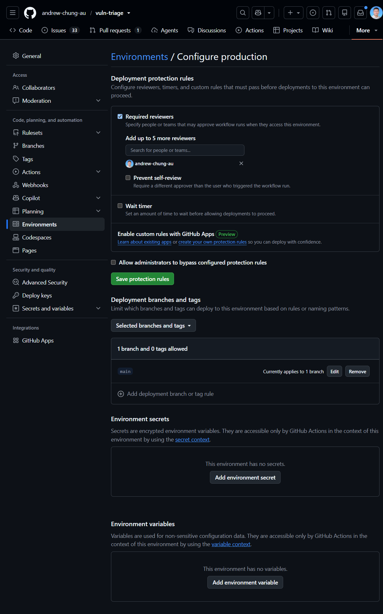
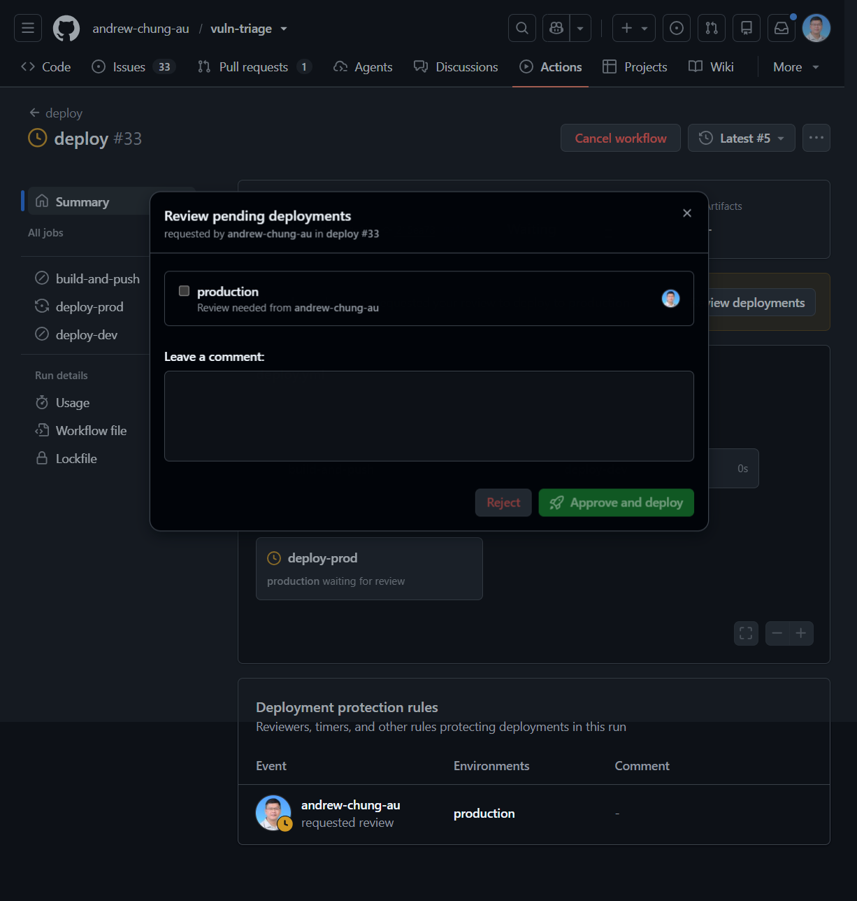
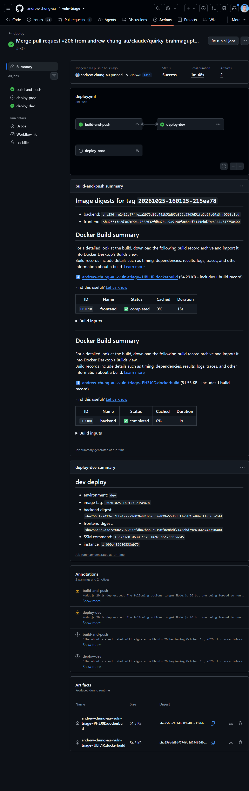
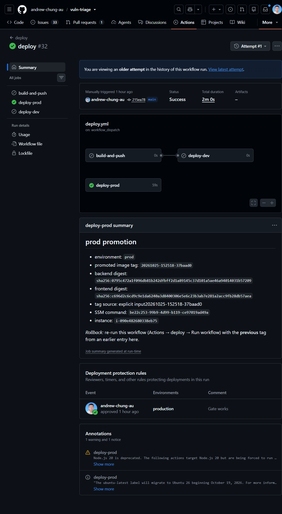
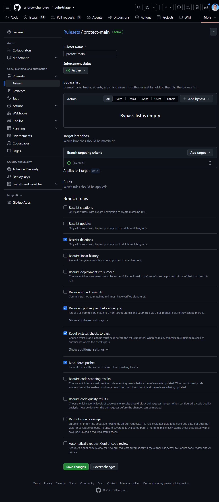
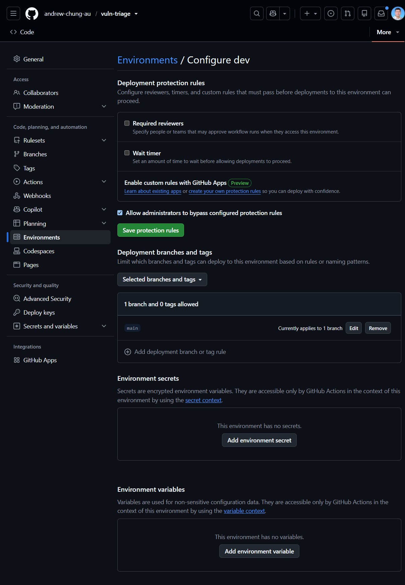
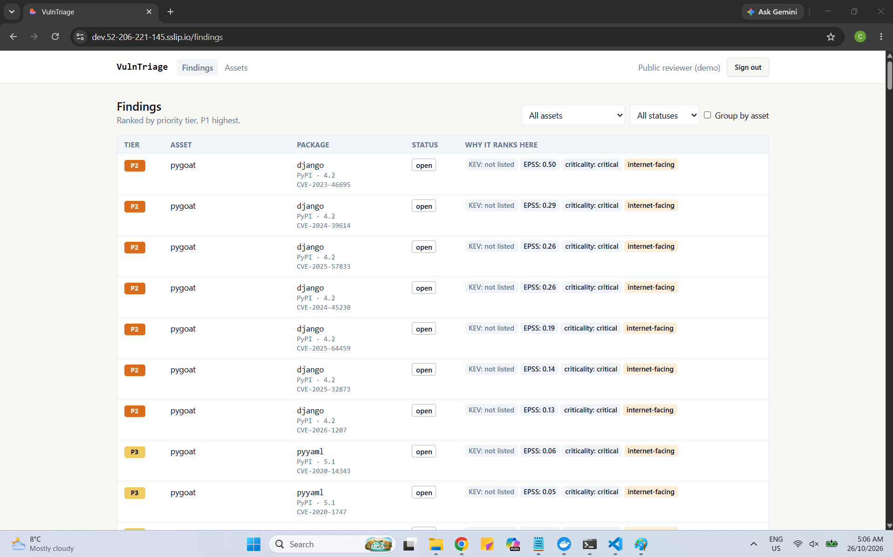
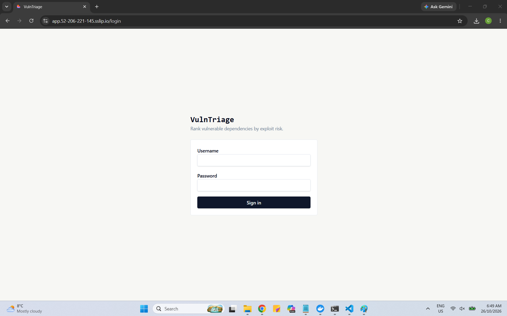

# Deployment

VulnTriage deploys to AWS from code: Terraform provisions one server, GitHub Actions builds and ships the images, and a protected production environment gates promotion.

> **Current status: the deployment is taken down.** It ran on AWS in October 2026 (dev deployed automatically on merge; production promoted manually, with a rehearsed rollback) and was torn down afterwards to avoid idle cost. Everything needed to recreate it is in [`terraform/`](../terraform) and [`.github/workflows/deploy.yml`](../.github/workflows/deploy.yml). The screenshots below were captured while it was live. To see the app without AWS, run [`make demo`](development.md#the-demo-recommended-first-look).

## Design in one page

| Decision | Choice | Why |
|---|---|---|
| Infrastructure as code | Terraform (OpenTofu runs the same files), three modules | Reviewable, repeatable, destroyable |
| Compute | **One** EC2 instance running `dev` and `prod` as two Docker Compose projects behind one Caddy reverse proxy | A single small server keeps the standing cost low; Compose matches local development |
| Images | Built once in CI, tagged `YYYYMMDD-HHMMSS-shortsha`, pushed to public GHCR, each digest recorded | Prod deploys the exact image dev ran; no rebuild on promotion |
| Hostnames and TLS | `dev.<elastic-ip>.sslip.io` and `app.<elastic-ip>.sslip.io`, Let's Encrypt via Caddy | No domain to buy; `sslip.io` resolves a name containing the IP back to it |
| Access | AWS Systems Manager Session Manager only: **no SSH port, no key pair** | Smaller attack surface; sessions are logged |
| CI credentials | **No long-lived AWS keys.** GitHub Actions assumes dev/prod roles through OIDC; the trust policy accepts only this repository's `dev` or `production` environment | Pull requests and other branches cannot deploy |
| Secrets | AWS Secrets Manager, read on the server by the instance role; the deploy workflow carries none | The deploy role cannot read secrets |
| Cost controls | Budget alert, nightly stop schedule, Elastic IP kept across stops, no load balancer / NAT gateway / RDS / ECS | Roughly $25–40 a month while up |

| Module | Path | Creates | State |
|---|---|---|---|
| Bootstrap | `terraform/bootstrap/` | The S3 bucket for Terraform state (versioned, private, encrypted) | Local, then moved into the bucket |
| Deploy roles | `terraform/deploy-roles/` | The GitHub OIDC provider (or reuses the account's) and the `dev` / `prod` deploy roles | The state bucket |
| Server | `terraform/server/` | EC2 instance, Elastic IP, security group (80/443 only), instance role, EBS data volume with daily snapshots, nightly-stop schedule, and a bootstrap that installs Docker and Caddy | The state bucket |

The full design, including the pipeline, rollback and teardown, is in [architecture.md](architecture.md) (Deployment). A security review of the Terraform is in [security-review.md](security-review.md).

## CI/CD

- **Every pull request** runs the [`verify`](../.github/workflows/verify.yml) workflow: unit, SQLite integration, frontend, OpenAPI validation, Postgres integration and telemetry jobs. Pull requests never receive an AWS role and never push images.
- **A merge to `main`** (when tests pass) builds the images once, pushes them to GHCR, records each digest, and deploys the `dev` project automatically. A red test leaves the previous version running. If the server is stopped, the deploy is skipped with a visible summary rather than reported as a pass.
- **Production** is a manual promotion: *Actions → deploy → Run workflow*. It pauses on the `production` environment until the required reviewer approves, then deploys an **existing** image tag (by default, the one running in dev). Nothing is rebuilt.
- **Rollback** is the same promotion with the previous tag, read from an earlier deploy-log entry. A failed pull leaves the running containers in place. Migrations are backward compatible for one release, so the previous image runs on the current schema.

The deploy workflow is gated by the repository variable `DEPLOY_ENABLED`, so merges do not try to deploy to a server that does not exist. Set it to `true` once the infrastructure is up (step 7 below).

### Evidence from the live deployment

| What it shows | Screenshot |
|---|---|
| **Production needs a reviewer.** The `production` environment has required reviewers on and "Allow administrators to bypass" off; only `main` can deploy |  |
| **A production deploy waiting for approval:** the job stops at "waiting for review" until the reviewer approves |  |
| **Dev deploys automatically on merge** (triggered by a push to `main`): build and dev deploy run, production is skipped |  |
| **Rollback rehearsal:** production deployed from an earlier image tag through the approval gate |  |
| **`main` is protected** by a ruleset: pull request required, empty bypass list, no force pushes, no deletion, seven required status checks |  |
| **Dev only deploys from `main`** |  |
| **The live dev site** showing ranked findings for the demo repositories |  |
| **The live production site:** the sign-in page over HTTPS (production had no public account) |  |

## Deploy your own

You own the AWS account, its credentials, the secrets and every `terraform apply`. Nothing in the repository holds an AWS credential, and CI never applies Terraform. AWS prices, console paths and some service behaviours drift: treat anything marked `VERIFY:` in the Terraform or architecture documents as something to check when you do the step.

**Rough cost** (on-demand, `us-east-1`; check the AWS Pricing Calculator): a `t3.medium` running all the time is about $30 a month, plus about $5–8 for volumes and the public IPv4 address, plus cents for secrets and the state bucket. With the nightly stop, about $25 a month, because volumes, snapshots and the Elastic IP are still charged while stopped. After teardown the standing cost is about zero.

### 1. Account and budget

1. Use an admin identity with MFA (IAM Identity Center preferred), not root. Confirm root has no access keys.
2. List old resources (Elastic IPs, volumes, snapshots) so a forgotten one is not mistaken for this project's.
3. Create a monthly AWS Budgets alert at 50 %, 80 % and 100 % **before** applying anything.
4. Pick one region (default `us-east-1`) for the state bucket, server and secrets.

### 2. GitHub settings

In the repository settings:

1. **Environments:** create `production` with yourself as required reviewer, restricted to `main`. Create `dev`, restricted to `main`.
2. **Variables** (none are secrets): `AWS_REGION`, `DEPLOY_ENABLED` (leave unset until step 7), and after step 3, `AWS_DEV_ROLE_ARN` and `AWS_PROD_ROLE_ARN`.
3. **Packages:** after the first image push, make the GHCR packages public so the server can pull without a credential.
4. **Ruleset:** keep `main` protected (pull request required, `verify` required, no force push). The responder relies on this: it may open pull requests, never push to `main`.

### 3. Apply the Terraform (by hand, in order)

Install Terraform (or OpenTofu). For each module copy `terraform.tfvars.example` to `terraform.tfvars` (git-ignored) and set the values.

1. `terraform/bootstrap`: `terraform init`, `terraform apply`, then move the state into the new bucket (`terraform/bootstrap/README-state.md`).
2. `terraform/deploy-roles`: check IAM → Identity providers for an existing `token.actions.githubusercontent.com` provider (an account may hold only one) and set `create_oidc_provider` accordingly. Apply, then copy the two role ARNs into the GitHub variables.
3. `terraform/server`: apply, then note the Elastic IP. Your hostnames are `dev.<eip>.sslip.io` and `app.<eip>.sslip.io` with the dots in the IP replaced by dashes.

Run `terraform plan` again after each apply; a clean apply shows "No changes". [`terraform/README.md`](../terraform/README.md) has the variables and defaults.

### 4. Check the Terraform before you apply

Static checks need no AWS credentials, so they are safe to run anywhere, including CI:

```sh
terraform fmt -check -recursive
terraform init -backend=false
terraform validate
```

Then read the plan against this checklist. These are the security-critical properties; a miss is a defect, not a preference.

- **Deploy roles:** the OIDC trust policy has audience `sts.amazonaws.com` and a subject limited to this repository's `dev` or `production` environment, with no wildcard over other repositories or pull requests. The dev role's policy only sends the deploy command and reads instance state (`ec2:DescribeInstances`); it has no mutating EC2 action, cannot change IAM or Terraform state, and cannot read secrets.
- **Server:** the security group opens 80 and 443 only, with no SSH and no key pair; one Elastic IP kept across the nightly stop; an EBS data volume with daily snapshots; the nightly-stop schedule is on by default; the instance role's SES permission (if used) is send-only and limited to one verified sender.
- **Everything:** every resource is tagged `project=vuln-triage`; no secret value, account id, access key or password appears in a `.tf` file; nothing from the "not used on purpose" list is created (load balancer, NAT gateway, RDS, ECS/EKS, CloudFront, an AWS container registry).

One known weakness is documented rather than hidden: both deploy roles use the generic `AWS-RunShellScript` document on the one shared server, so IAM cannot stop the dev role from running arbitrary commands on the host that also serves prod. The compensating controls are process (merged `main` only, environment branch restriction, production approval). The fix, a custom SSM document per environment, is on the [roadmap](roadmap.md#operations-and-hardening).

### 5. Secrets and email

Create one JSON secret per environment in Secrets Manager (`vuln-triage/dev`, `vuln-triage/prod`) containing at least `POSTGRES_PASSWORD`, plus the read-only GitHub token (`contents: read` on the repositories you will scan). Generate values with a password manager or `openssl rand -base64 32`. Never paste a secret into an issue, a chat or a file in the repository.

Owner notification email uses the Amazon SES API with the instance role from one verified sender address (`sslip.io` names cannot carry the DNS records SES domain verification needs, so verify an address, not a domain). New SES accounts start in a sandbox that only allows verified recipients, which is a safe default for a public demo. Development and tests send to MailHog and need nothing from you.

### 6. Seed demo data

Once dev answers, register the demo assets through the API (never by writing to the database):

```sh
python deploy/seed-pilot.py --base-url https://dev.<eip>.sslip.io/api --username <security-lead>
```

The base URL must end in `/api`. The password is prompted or read from `VT_SEED_PASSWORD`. Edit `deploy/pilot-seed.json` first to list your own repositories. Running it twice registers the assets twice. If you expose the dev site publicly with a shared demo login, treat it as hostile: anyone signed in can register assets (each starts a scan using the server's read-only token), keep mail off or the SES account in sandbox, keep nothing real in it, and delete the account when you are done.

### 7. First deploy

1. Set the `DEPLOY_ENABLED` repository variable to `true`.
2. Merge a change to `main`. The workflow builds, pushes the images, and deploys `dev`. Check `https://dev.<eip>.sslip.io` shows the sign-in page over HTTPS. If Let's Encrypt refuses the shared `sslip.io` name (rate limits), fall back to its staging certificate, then to another hostname service such as `nip.io`.
3. Create the production secret, then promote: *Actions → deploy → Run workflow*, approve on the `production` environment, and check `https://app.<eip>.sslip.io`.
4. Rehearse a rollback by promoting an earlier tag.

### 8. Teardown

1. Export anything to keep (a production database dump).
2. `terraform destroy` for the server module, then deploy-roles.
3. Delete the EBS snapshots, the secrets (without a recovery window), the budget and any GHCR images you do not want.
4. Last, empty and delete the state bucket (a versioned bucket needs every version removed).
5. Search for resources tagged `project=vuln-triage` and confirm none remain, release any stray Elastic IP, and check Cost Explorer a few days later.

## Operating notes

- **Nightly stop.** The server stops each night. Start it from the console before a demo. While it is stopped the backend runs a catch-up refresh and re-scan on start if the last run is over 24 hours old, and an automatic dev deploy is skipped and reported (re-run it after starting the server). Turn the schedule off with the Terraform variable `nightly_stop_enabled`.
- **Cost allocation.** After the first apply, activate the `project` tag in Billing → Cost allocation tags so Cost Explorer can show this project's spend alone.
- **Observability and the responder** run in local Docker Compose, not on AWS. Deploying them is on the [roadmap](roadmap.md#cloud-observability).
