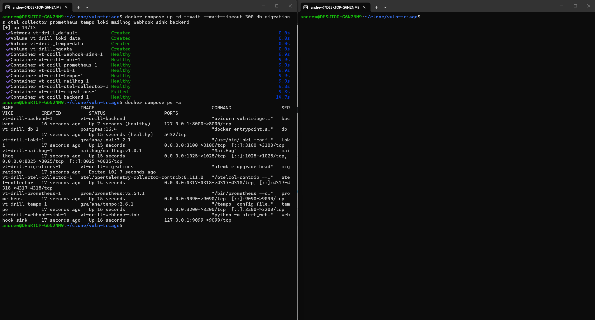
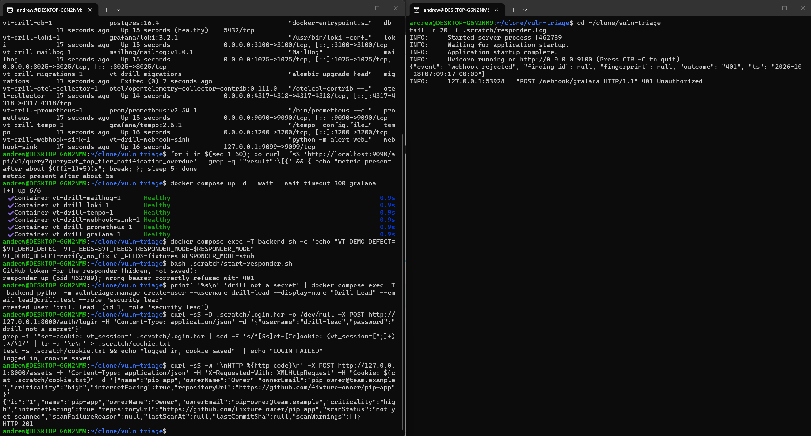
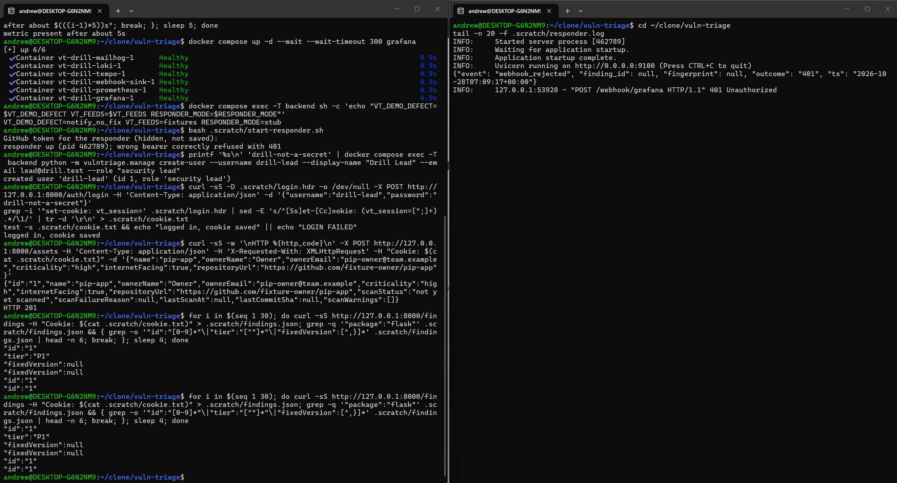
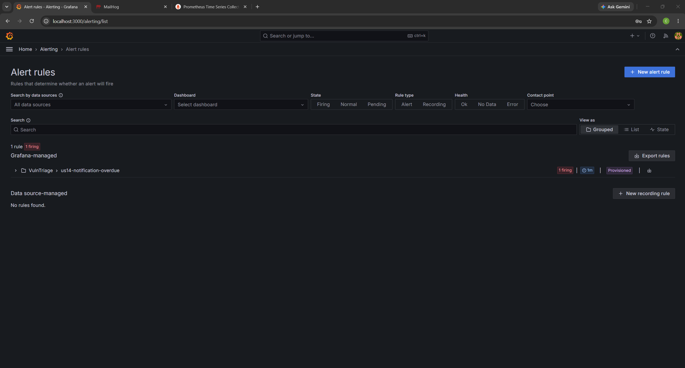
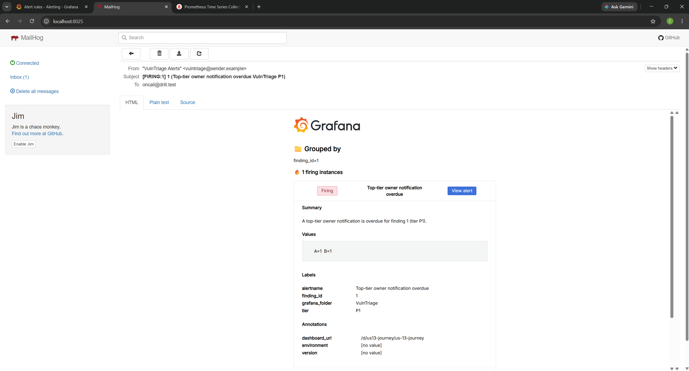
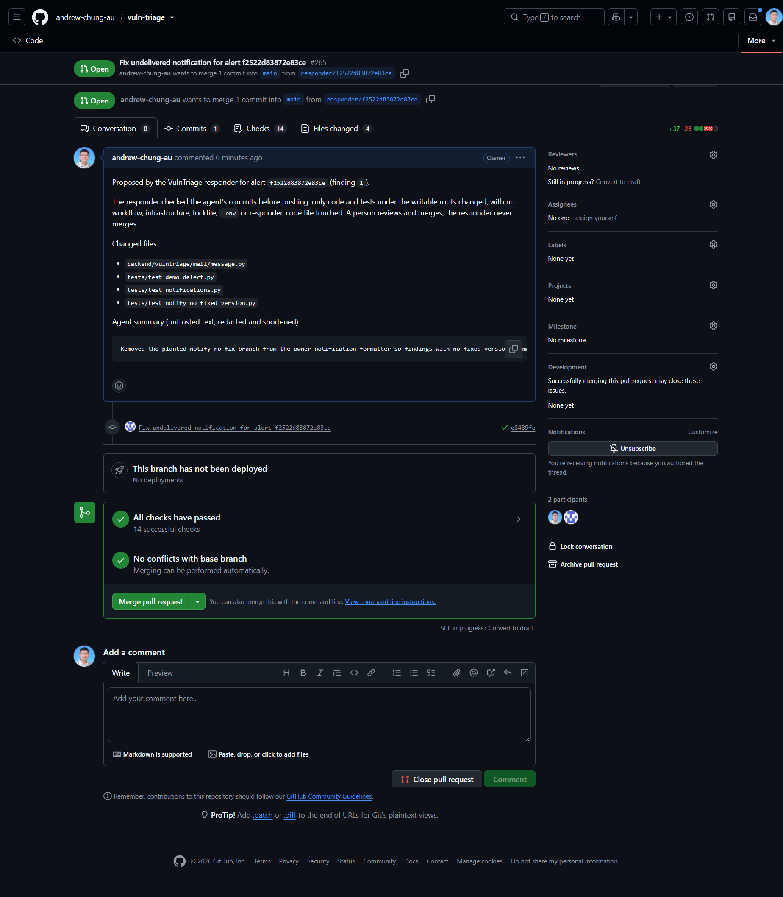
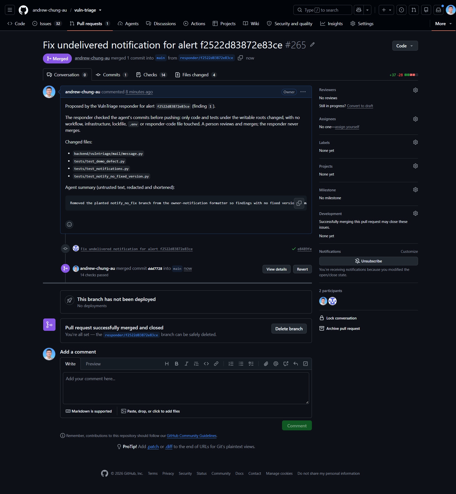
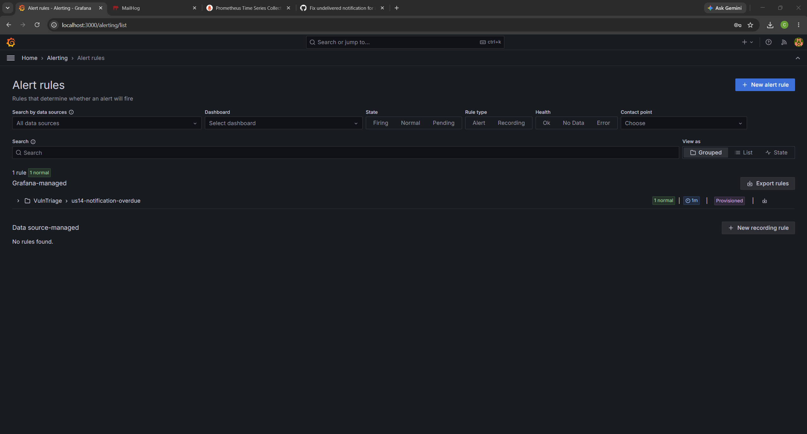
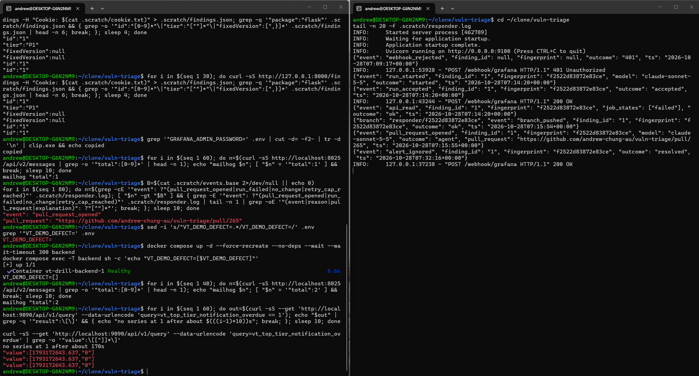
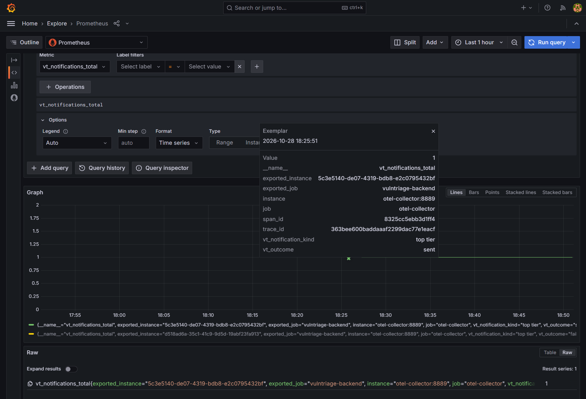

# On-call responder agent

When VulnTriage's alert fires because a top-priority finding was not delivered, a responder service wakes up, hands the failure to a headless coding agent, and opens a pull request with a fix and a test. A person reviews and merges it. The responder never merges, never pushes to `main`, and every action it takes is logged.

This page covers how it works, how the agent is bounded, what is and is not guaranteed, and the evidence from a recorded live run.

## How a run works

```
Grafana alert ─▶ webhook (returns 202 at once) ─▶ background run:
  clone fresh checkout ─▶ make install (runner, no secrets) ─▶ record base commit + .git/config digest
  ─▶ headless `claude -p` agent: read, edit, run tests, `git add`, `git commit`   [own process group, time limit]
  ─▶ kill the agent's process tree
  ─▶ runner-side diff gate ─▶ runner builds ONE commit ─▶ git push responder/<fingerprint> ─▶ open pull request
  ─▶ read the PR back and confirm it is this run's ─▶ remove the checkout ─▶ clean up a branch this run created if the run failed
```

**The agent only commits locally.** The runner, not the agent, checks the result, pushes the branch and opens the pull request. That split keeps the push credential out of the agent's environment entirely.

| Mode | What it is | Used for |
|---|---|---|
| `RESPONDER_MODE=stub` | No model, a fake GitHub client | CI: the alert → webhook → responder path, the repeat-alert guard and the Compose wiring |
| `RESPONDER_MODE=real`, `RESPONDER_RUNTIME=cli` (default) | One headless `claude -p` per alert on the operator's own Claude login. No API key | The live run below |
| `RESPONDER_MODE=real`, `RESPONDER_RUNTIME=sdk` | An Agent SDK session that needs `ANTHROPIC_API_KEY` and lets the agent push | Earlier runtime. Never run against a live session; retained until a cleanup |

The service lives in [`responder/`](../responder). Each alert is deduplicated by fingerprint, so a repeat alert for the same finding does not start a second run, and a `resolved` notification is logged and ignored.

## How the agent is bounded

Defence in depth, in the order it acts. No single layer is relied on.

1. **No push credential in the agent.** The CLI's environment is built from scratch: allowlisted system variables, `HOME`, the Claude login variables, a run marker and a git identity. `ANTHROPIC_API_KEY`, `ANTHROPIC_AUTH_TOKEN`, `GH_TOKEN`, `GITHUB_TOKEN`, `RESPONDER_*` and `GIT_CONFIG_*` are removed even if someone adds them to an allowlist, and tests plant each one and assert the fake CLI never sees it. An API key left in the environment would override the login and bill the API, which is the second reason for the scrub. The runner hands the git token to its own `git push` call only.
2. **A generated allow and deny list.** Built from one policy module: edits only under `backend/`, `tests/`, `frontend/` and `responder/`; `make test`, `make backend-test`, `make responder-test`; `git status|diff|log`; `git add <one path under a writable root>`; and `git commit -m "<message>"` in exactly one shape. Denied: `git push`, `gh`, `curl`, `wget`, `ssh`, package managers, web tools, `make install`, and edits to `.github/`, Terraform, `deploy/`, `ci/`, `.env*`, Dockerfiles, Compose files, lockfiles and the responder's own policy code. `--permission-mode dontAsk` refuses everything else, since a headless run cannot ask. Deny always beats allow.
3. **The runner-side diff gate.** Independent of the CLI, before any push. A refusal is a failed run with a short reason code and nothing is pushed.

   | Check | Refused when |
   |---|---|
   | Repository integrity | `.git/config` changed from its post-clone digest (checked at the start and again before the push), or `.git` is a symlink or holds `commondir`, `gitdir`, `config.worktree`, grafts or alternates |
   | History shape | No new commit, a head that does not descend from the cloned head, any merge commit, or more than `RESPONDER_MAX_COMMITS` (default 3) |
   | Changed paths | Any file outside the writable roots, or on `.github/`, infrastructure/CI/devcontainer paths, an `.env*` file, a lockfile or the responder's policy code; more than 40 files; a path over 200 characters or with characters outside a safe set |
   | File kinds | A symlink, a submodule (gitlink), a type change, a new executable, a mode change, a rename or copy |

   Every runner git call pins `GIT_DIR` and `GIT_COMMON_DIR` to the checkout's own `.git`, ignores global and system git config, switches off hooks and fsmonitor, reads objects without replace refs, never forces, and pushes `<sha>:refs/heads/responder/<fingerprint>` to an explicit `https://github.com/<repo>.git` URL. **What is pushed is one commit the runner builds** from the checked tree, so the agent's own commits never leave the machine. The pull request title and body are composed by the runner from the validated fingerprint and finding id and the checked file list; the agent's one-line summary is redacted, cut to 300 characters and fenced.
4. **Token scope and `protect-main`.** The runner's GitHub token is fine-grained and limited to this repository, with Contents and Pull requests read/write and Administration none. Fine-grained tokens cannot be limited to a branch, so protection of `main` comes from the repository ruleset: pull request required, empty bypass list, no force pushes. An owner-run proof showed that a push to `main` with this token is rejected and a push of a `responder/<fingerprint>` branch succeeds. A bug in the gate therefore still cannot change `main` without a reviewed merge.
5. **Run limits.** A turn limit (`RESPONDER_MAX_TURNS`, default 30) and a wall-clock limit. The CLI runs in its own process group, killed as a group on timeout and again by the per-run environment marker before the checkout is removed. There is no dollar cap on a plan; the turn and time limits bound usage.
6. **Startup preflight.** The service refuses to start unless `claude` is on `PATH`, supports every required flag, is logged in, and the auth method is a subscription login (`claude.ai` or `oauth_token`). Methods that could bill something else (`api_key`, `api_key_helper`, `third_party`) are refused, and the preflight runs with the same scrubbed environment as a run.

### Failure reasons

Every failed run logs one reason: `cli_exit_nonzero`, `output_too_large`, `plan_usage_limit`, `max_turns`, `output_unparseable`, `result_line_missing`, `agent_cli_error`, `agent_escalated`, `agent_timeout`, `checkout_failed`, `install_failed`, or a diff-gate reason such as `diff_path_<code>` or `git_config_modified`. A non-zero exit is never treated as success. `RESULT: FALSE_POSITIVE` pushes nothing and logs the explanation. Agent text that reaches a log (an escalation explanation, denied calls) is sanitised, redacted against the configured secrets over the whole text first, and only then cut to a short window, so a secret is never bisected into an unredacted fragment.

## What is not guaranteed

The tool policy is a guardrail against a *confused* agent, not a sandbox against a hostile one. Stated plainly:

- **The Claude login is readable by code the agent runs.** The CLI needs `~/.claude/.credentials.json`, and any process the agent starts (a test, a `conftest.py`) runs as the same user. So can files under `HOME` such as `~/.netrc`, `~/.aws` or SSH keys. The environment scrub covers variables only. Run it on an account whose `HOME` holds nothing else of value.
- **Egress is unrestricted.** Proxy and CA variables are allowed because the CLI needs the network, and the agent's own code can reach the network. A container whose egress is limited to the Anthropic API and GitHub would close this and is not built.
- **Rules cannot express everything.** Argument-constraining Bash rules are fragile: a program written in another spelling (`/usr/bin/curl`, `sh -c`) is not matched by a deny rule, though `dontAsk` still refuses it. Shell expansion, case-insensitive paths and symlinks are left to the diff gate. The tests check the rules against this repository's *model* of the CLI's matching, with a differential test over thousands of generated commands, not against the real CLI.
- **The gate reads a repository the agent's code could write to.** Its refusals are a list of things thought of, and QA found and fixed several bypasses by hand. Two residuals remain: a process that escapes the process-group and marker kill (`env -i`, `setsid`) could edit `.git/config` in the short window before the push, and the gate cannot judge what an allowed file's code *does*. That is what human review and `protect-main` are for.
- **The policy code is protected from the agent, not from a human merge.** The gate refuses a diff touching `responder/vt_responder/`, so an agent cannot weaken it through a pull request it opens.

This risk was accepted for a supervised, recorded run on a throwaway demo defect. It would need to be revisited before any unattended or production use: run the responder in a container with limited egress and a throwaway `HOME`.

## Live run

The recorded run: **[VulnTriage Demo Responder](https://youtu.be/B4OvaHqAeyI)** (unlisted video). It used the local Compose stack with a planted defect switched on (`VT_DEMO_DEFECT=notify_no_fix`, which makes the owner-notification formatter fail for a finding with no fixed version), the recorded fixtures (`VT_FEEDS=fixtures`, demo data), and the real responder (`RESPONDER_RUNTIME=cli`, a headless `claude -p` agent) on the host. The agent's pull request is [#265](https://github.com/andrew-chung-au/vuln-triage/pull/265); the owner merged it, because the responder cannot.

| Step | What it shows | Screenshot |
|---|---|---|
| 1 | **The stack is up:** every container healthy; `migrations` is a one-shot job and shows `Exited (0)` |  |
| 2 | **The failing asset is registered and scanned:** a top-tier (`P1`) finding with no fixed version |  |
| 3 | **The overdue metric reaches 1** (`vt_top_tier_notification_overdue`) |  |
| 4 | **Exactly one Grafana alert fires** and its email names the finding |   |
| 5 | **The responder opens a pull request** with a fix and a test, after its diff gate |  |
| 6 | **The owner merges it** |  |
| 7 | **The alert resolves.** The responder's action log: `run_started` 07:14:20 UTC, `branch_pushed` 07:15:54, `pull_request_opened` 07:15:55, then `alert_ignored` with outcome `resolved` at 07:32:16 and no new run |   |
| 8 | **Metric → trace:** an exemplar on `vt_notifications_total` carries a `trace_id` and `span_id` |  |

**How to read this evidence honestly.**

- It is a scripted drill. The agent is told in its prompt that the code behind `VT_DEMO_DEFECT` is a deliberately planted defect and that fixing it is its task. Without that sentence an earlier live run escalated, because the defect looked deliberate. So the agent fixes a bug it was told was planted; it still has to find it, reproduce it, add a test and stay within every other rule.
- The planted defect has since been removed by the responder's own pull request, so the Compose `responder` workflow, which injects that defect, no longer passes. It runs manually until it is rebased on another way to inject a failure. See the [roadmap](roadmap.md#known-limitations).
- Details of the real CLI that the run did not confirm remain unverified: how a plan usage limit surfaces (exit code and JSON), whether `Write` falls under `Edit` path rules, whether a Bash call refused by `dontAsk` is listed in `permission_denials`, and how a real tab in a command is matched. The live run measured one relevant behaviour: the CLI reads a control-whitespace character inside a rule *pattern* as a plain space, which made an early commit rule deny every commit with a space in its message. Those patterns were removed and the model corrected.
